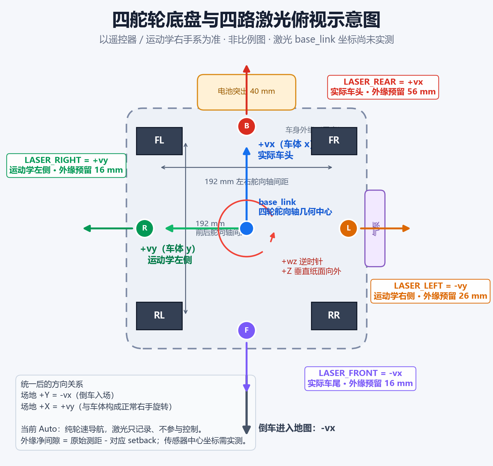
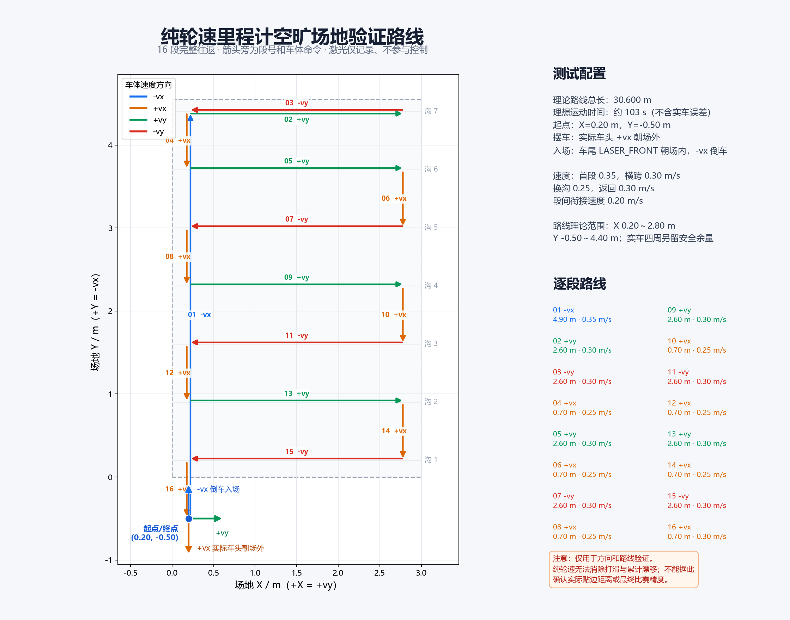

# Longinus MCU

STM32H723 四舵轮底盘。支持遥控驾驶和固定路线 Auto 测试。

**当前 Auto 是空旷场地纯轮速路线验证版。** 只使用四轮反馈里程计和轮速航向闭环；激光保留接收与日志，但不参与纠偏、端点制动、自检或停车等待。`MAP_ROUTE_LASER_GUIDANCE_ENABLED = 0`，后续完成方向和安装标定后再启用激光引导。

## 当前车体坐标系与摆车方向

以遥控器和舵轮运动学的右手系为准：`+vx` 是实际车头，`+vy` 是运动学左侧，`+wz` 逆时针。`base_link` 位于四个舵向轴的几何中心；`192 × 192 mm` 是舵向轴间距，不是整车包络。



| 运动学方向 | 激光枚举 | 当前外缘预留量 |
| --- | --- | ---: |
| `+vx`，实际车头 | `LASER_REAR` | 56 mm |
| `-vx`，实际车尾 | `LASER_FRONT` | 16 mm |
| `+vy`，运动学左侧 | `LASER_RIGHT` | 16 mm |
| `-vy`，运动学右侧 | `LASER_LEFT` | 26 mm |

摆车时，实际车头 `+vx` 朝场外，车尾 `LASER_FRONT` 朝场内，以 `-vx` 倒车进入地图。名义起点为场地 `(X, Y) = (0.20, -0.50) m`，并固定使用正常右手旋转：

```text
场地 +X = +vy
场地 +Y = -vx
```

外缘净间隙使用 `原始测距 - 对应 setback`。上图中的传感器位置仅表示方向；四路发射点相对 `base_link` 的实际坐标仍需测量。

## 空旷场地纯轮速路线图



路线共 16 段、理论行程 30.600 m，从第 7 沟外侧开始，横跨后返回，再逐沟向入口推进，最后回到起点。第 01 段 `-vx` 4.90 m，第 02 段 `+vy` 2.60 m，第 03 段 `-vy` 2.60 m；后续方向见图。

验证速度为首段 `0.35 m/s`、横跨 `0.30 m/s`、换沟 `0.25 m/s`、返回 `0.30 m/s`，段间衔接 `0.20 m/s`。理想运动模型约 103 s，不包含实车打滑、舵向延迟和停车误差。路线理论范围为 `X = 0.20～2.80 m`、`Y = -0.50～4.40 m`，空旷测试时四周必须另留安全余量。

使用 `SWD = 2000` 请求 Auto。纯轮速无法消除打滑和累计漂移，本版本只用于确认方向、段序和名义路线，不能据此验证实际贴边精度或比赛成绩。

## MCU 运行流程

1. `main()` 初始化 MPU、HAL、时钟和外设。随后调用 `entry_init()`。
2. `entry_init()` 装配时基、日志、灯带、IMU、里程计、底盘、激光和遥控。接着初始化应用，启动 TIM6。激光装配失败会记录日志，启动继续。
3. TIM6 每 2 ms 在中断中累加节拍。主循环按 500 Hz 处理底盘反馈、激光数据和控制。里程计按 250 Hz 更新，遥控按 100 Hz 更新。积压节拍合并执行，漏拍与超过 2 ms 的周期记入 `SCHED`。
4. `app_runtime` 检查遥控、里程计和电机状态。状态机决定执行 Manual、Auto 或停机。底盘反馈在停机状态仍会被读取。

入口见 [main.c](Core/Src/main.c)、[entry.h](src/app/entry.h)、[app_runtime.c](src/app/app_runtime.c) 和 [assemble_tim.c](src/service/assemble/assemble_tim.c)。

| 模块 | 职责 |
| --- | --- |
| `Core/`、`robot.ioc` | CubeMX 外设配置与启动入口。 |
| `src/platform/` | HAL 适配。处理 CAN、UART、SPI、EXTI、TIM 和 DWT。 |
| `src/service/assemble/` | 绑定硬件、SDK 驱动与实车配置。中断接收的 CAN 数据由主循环取出处理。 |
| `src/service/` | 遥控输入、底盘控制、轮速航向保持、纯轮速里程计和激光测距；保留可选 IMU 接口。 |
| `src/domain/kalman/` | 保留轮速与 IMU 融合实现。当前 `wheel_only = true`，不初始化或使用该融合器。 |
| `src/app/` | 调度、状态切换、故障处理、手动映射、自动路线和状态显示。 |

| 外设 | 用途 |
| --- | --- |
| FDCAN1 / FDCAN2 | 1 Mbit/s。分别连接达妙舵向电机与 DJI M2006 驱动电机。 |
| FDCAN3 | 1 Mbit/s。接收 S21C 的经典 CAN 标准数据帧 `0x601`。8 字节依次存前、后、左、右四路距离。每路为大端 `uint16_t`，单位 mm。当前只记录，不控制 Auto。 |
| UART5 | 115200 baud。FS-iA10B 遥控接收。 |
| SPI2、EXTI | BMI088 读数与数据就绪信号；当前纯轮速路线不依赖其数据。 |
| SPI6、BDMA | WS2812 状态灯带。 |
| USART1 | 115200 baud。输出日志与 VOFA 调试数据。 |

底盘接收 `(vx, vy, wz)`，逆解为四轮舵角和轮速。舵向选用就近等效角，可配合驱动反转。轮角与轮速经正解回到车体速度，再由纯轮速里程计积分位置、航向和角速度。启用先转后走时，舵角到位前驱动速度为零。零速指令保持舵向，满足静止条件后可保持驱动位置。见 [chassis.c](src/service/chassis.c)、[assemble_chassis.c](src/service/assemble/assemble_chassis.c)、[assemble_odom.c](src/service/assemble/assemble_odom.c) 和 [odom.c](src/service/odom.c)。

## 模式与遥控

| 状态 | 行为 |
| --- | --- |
| `Idle` | 默认状态。关闭电机输出，读取反馈。 |
| `Manual` | 先检查三个控制轴回中，再以零目标准备电机。底盘与纯轮速里程计就绪后接收摇杆指令。 |
| `Auto` | 先以零目标准备电机，检查遥控、底盘和轮速里程计；就绪后执行路线，不要求 IMU 或激光在线。 |
| `Fault` | 锁存遥控掉线、里程计或底盘错误，关闭电机输出。可恢复故障清除后回到 `Idle`。 |
| `EStop` | 急停事件进入此状态。关闭输出，状态机保持锁定。 |

- 遥控超时为 100 ms。电机准备总超时为 3 s。停机失败后每 100 ms 重试。
- `SWD = 1000` 请求 Manual，`SWD = 2000` 请求 Auto。两种模式切换时先停机，并清空路线进度。
- 右摇杆 Y 控制 `vx`，右摇杆 X 取反控制 `vy`，左摇杆 X 取反控制 `wz`。通道中心为 1500，死区为 ±10，偏差除以 500 后限幅。
- `SWB = 2000 / 1500 / 1000` 对应快 / 中 / 慢档。平移上限依次为 2 / 1 / 0.5 m/s，旋转上限为 8 / 4 / 2 rad/s。
- `SWC = 2000` 关闭先转后走，`SWC = 1500` 开启。`SWC = 1000` 或 `VRA ≤ 1200` 请求制动。其余情况下，`VRB > 1200` 给零速。
- `SWC = 1000` 且 `VRA、VRB ≤ 1200` 是停机与清故障组合。进入组合时触发一次。保持组合期间持续停机。
- 手动平移时可锁航向。Auto 锁定路线起始轮速航向。纯轮速航向环参数为 `kp = 8`、`kd = 0.25`、`wz_limit = 0.55 rad/s`，角速度反馈同样来自轮速正解；平移门槛为 0.01 m/s，主动旋转门槛为 0.08 rad/s。

自检只综合遥控、纯轮速里程计、底盘和故障状态，不要求激光在线。灯色为红（未就绪）、绿（自检通过）、蓝（Manual）、橙（Fault）、紫（EStop）。USART1 每 1 s 输出心跳和诊断。里程计就绪时每 100 ms 尝试发送 VOFA 数据，激光在线时每 150 ms 尝试发送测距日志。见 [remote.c](src/service/remote.c)、[app_control.c](src/app/app_control.c)、[app_fsm.c](src/app/app_fsm.c) 和 [app_status.c](src/app/app_status.c)。

## 历史激光调参资料（当前纯轮速版本不执行）

> **以下内容是旧 14 段融合里程计／激光闭环版本的历史记录，不是当前路线。** 当前路线以本文顶部和 [map_route.c](src/app/map_route.c) 为准，共 16 段，`MAP_ROUTE_LASER_GUIDANCE_ENABLED = 0`。下文中的旧坐标方向、速度、段数、自检条件和激光启动逻辑均不可直接用于本次空旷场地测试；后续重新启用激光前，必须重新核对四束方向、安装偏移和专用起步算法。

路线和纠偏参数位于 [app_odom_test.c](src/app/app_odom_test.c)。第一段开始时用融合里程计的当前位置和 yaw 建立路线坐标并锁定航向。按实车约定，软件 `−vx` 朝车头和前束 `F`，`+vx` 朝车尾和后束 `B`。左束 `L` 指向 `+Y`，右束 `R` 指向 `−Y`。`+wz` 为逆时针。沿 `vx` 行驶时调 Y 轴横移，沿 `vy` 行驶时调 X 轴横移。

### 调度、起步和测距量程

| 参数 | 当前值 | 生效条件和作用 |
| --- | --- | --- |
| `APP_ODOM_TEST_CONTROL_PERIOD_S` | `0.002 s` | 传给航向环的名义调用周期。TIM6 决定实际调度节拍，横移增速则使用相邻控制周期的实际时间。 |
| `APP_ODOM_TEST_CORRECTION_START_M` | `0.01 m` | 主轴按计划方向走到 10 mm 时标记本段已移动，记下当前 CAN 帧号和时间。接下来只用新帧开始跟踪。减小会更早接入，也更容易使用起步时还没看准参考面的读数。 |
| `LASER_VY_DELAY_MS` | `180 ms` | `vy` 段确认已移动后，激光接收时间须再晚至少 180 ms 才能启用。计时期间主轴继续走。`vx` 段只需新帧。已经进入停车流程时可跳过该延时。 |
| `LASER_CAN_TIMEOUT_MS` | `250 ms` | 从最近一次 CAN 收帧计算在线状态。整条路线曾确认移动后，正在执行的段遇到全帧超时报里程计错误，段间则给零速等待恢复。单束失效仍可能保持 CAN 在线。 |
| `LASER_MIN_RANGE_MM` | `70 mm` | CAN 原始诊断 `valid_mask` 的下限，也是停车重定位做目标配置校验时使用的原始距离下限。该配置校验会先把安装后退量加回目标间隙。 |
| `LASER_FIELD_MIN_RANGE_MM` | `20 mm` | Auto 行驶跟踪、段末微调原始帧以及四束算法接入使用的近距下限。原始读数低于 `20 mm` 时会被量程检查滤除。 |
| `LASER_MAX_RANGE_MM` | `7500 mm` | CAN 诊断、Auto 原始测距筛选及停车目标配置所用的原始距离上限。超大报码会被量程检查挡掉。 |
| `s_sensor_setback_mm` | `F/B/L/R = 0/0/0/0 mm` | 各束发射点相对同方向车身外缘的后退量。原始读数扣除该值才用于和间隙带比较。当前为零，原始读数与代码使用的间隙数值相同。 |
| `LASER_MM_PER_CM` | `10 mm/cm` | 固定单位换算，用于路线表中的段末间隙和 X 门槛。路线表填 `45` 表示 450 mm。 |
| `APP_ODOM_TEST_ROUTE_COUNT` | `14` | 从 `s_route` 实际编入的数组元素数得出，用于段号和路线结束判断。注释中的第 15 段未计入。 |

接收和量程定义见 [laser_odom.c](src/service/laser_odom.c)、[laser_odom.h](src/service/laser_odom.h) 和 [laser_field.h](src/service/laser_field.h)。

### 巡航距离带与边界跟踪

| 配置 | `min_mm` | `max_mm` | `capture_max_mm` | `direction` 与用途 |
| --- | ---: | ---: | ---: | --- |
| `s_side_band` | `45` | `50` | `197.5` | `vx` 段只读取 `side` 指定的侧束。左 `+1`、右 `−1`，使用同一间隙带并镜像输出。 |
| `s_front_band` | `30` | `35` | `65` | `vy` 段前束 `F` 朝 `−X`，方向 `−1`。 |
| `s_rear_band` | `25` | `30` | `60` | `vy` 段后束 `B` 朝 `+X`，方向 `+1`。 |

`min_mm` 是所选束允许的最小目标间隙，低于它时远离该侧参考面。`max_mm` 是最大目标间隙，高于它时靠近参考面。进入目标带即把横移目标降到零。`capture_max_mm` 只限制首次捕获及跳变后的重新确认，已锁定的边界可以在位置连续性通过时继续使用。`direction` 表示波束在对应纠偏轴上的正负方向。`vy` 巡航必须前后束都跟踪有效，且两个目标区间有交集，才使用激光修正 X。缺一束或区间冲突时，继续执行主轴 `vy`，X 改用里程计直线回退。

| 参数 | 当前值 | 生效条件和作用 |
| --- | --- | --- |
| `LASER_TRACK_JUMP_MM` | `12 mm` | 对比补偿车身横移后的新边界坐标与已锁定边界。超过 12 mm 进入重新确认。放宽可容忍参考面或里程计的小波动，也容易接纳另一反射面。 |
| `LASER_TRACK_STABLE_MM` | `5 mm` | 新边界与候选首帧坐标的允许偏差。超过时用新帧重建候选，并重新计时、计数。 |
| `LASER_TRACK_CONFIRM_FRAMES` | `3 帧` | 首次锁定或重锁的最少独立 CAN 帧数。主循环重复读同一帧不会增加计数。 |
| `LASER_TRACK_CONFIRM_MS` | `100 ms` | 候选从首帧到最新帧的最短时间。帧数和持续时间需同时满足。缩短会更快接管，也更容易接受短时错面。 |
| `LASER_TRACK_GAIN` | `0.5` | 可信边界坐标的更新权重，用于后续连续性判断。纠偏计算使用最近通过检验的边界观测，并用里程计换算到当前时刻。 |
| `LASER_TRACK_MAX_AGE_MS` | `120 ms` | 巡航时激光过期就清除跟踪并由里程计直线接管。段末遇到超差帧时，最多沿用到上一可信帧的帧龄达到 120 ms。持续收到坏帧不会更新可信帧时间。 |
| `ODOM_LINE_DEADBAND_M` | `0.005 m` | 回退时横向误差的死区。参考是最近一次激光可用时记录的横向位置，尚无参考则用本段起点。超过 5 mm 的部分才用于回退纠偏。 |

### X、Y 纠偏和回退参数

| 配置 | 生效阶段 | `kp`（s⁻¹） | `limit_mps`（m/s） | `accel_mps2`（m/s²） |
| --- | --- | ---: | ---: | ---: |
| `s_y_correction` | `vx` 巡航，输出 Y 横移 | `2.1` | `0.08` | `0.30` |
| `s_x_correction` | `vy` 巡航，输出路线 X 横移 | `2.1` | `0.08` | `0.30` |
| `s_odom_correction` | 巡航时无可用激光纠偏，输出当前段的法向速度 | `2.1` | `0.03` | `0.30` |
| `s_end_y_correction` | `vx` 段末，沿路线 Y 低速对边 | `1.5` | `0.04` | `0.20` |

| 字段 | 作用 |
| --- | --- |
| `kp` | 将有效误差的绝对值从 m 换算成目标横移速度。例如 `2.1 × 0.010 m` 得到 `0.021 m/s`。误差符号决定方向。增大会提高未触限时的力度，也更容易使指令饱和。 |
| `limit_mps` | 横移速度幅值上限。达到上限后继续加大 `kp` 只会让饱和更早出现。它限制纠偏量 `corr`，主轴速度仍由路线表给出。`vy` 段的 `vx_cmd` 是合成速度转成车体系后的分量，包含航向偏差带来的投影。 |
| `accel_mps2` | 同方向纠偏幅值的最大上升速度。每周期允许增加 `accel_mps2 × dt`，代码把 `dt` 封顶为 `20 ms`。进入目标带、误差减小或换向时可立即减小原指令。切换激光与里程计时从零重新起量。 |

### 段末侧向微调和停车重定位

| 参数 | 当前值 | 生效条件和作用 |
| --- | --- | --- |
| `APP_ODOM_TEST_STOP_SPEED_MPS` | `0.02 m/s` | 用融合速度 `hypot(vx, vy)` 判定平移是否停稳。降到此值或更低才开始静止计时，用于 `vx` 微调前、微调到带内后及停车重定位前。 |
| `LASER_STOP_TIMEOUT_MS` | `2000 ms` | 从下达段末停车算起，超时仍高于平移停稳速度就报里程计错误。`vx` 完成或跳过微调回到停车重定位时重新计停车时间。 |
| `LASER_SETTLE_MS` | `150 ms` | 停稳后只采用时间戳至少晚 150 ms 的帧。用于开始段末跟踪、确认在带内停稳和停车重定位。 |
| `LASER_END_TRIM_LIMIT_M` | `0.05 m` | 同时限制段末侧束的带外误差和从微调起点算起的净横向位移。第 01 段目标为 `450–550 mm`，允许检查 `400–600 mm` 内的侧距。超差帧滤除，净横向位移达到 50 mm 时结束微调。增大会同时放宽这两处限制。 |
| `LASER_END_TRIM_INSET_M` | `0.01 m` | 侧距在目标带外时，临时把纠偏误差再向带内加最多 10 mm，且不超过带宽的一半。用于提高临近边界时的起量，进入目标带即可归零。 |
| `LASER_END_TRIM_TIMEOUT_MS` | `2000 ms` | 从 `vx` 首次停稳进入微调起计，包含等待新帧和实际微调时间。超时记录 `LASER END ... limit`，随后走停车重定位。 |
| `LASER_END_YAW_LIMIT_RAD_S` | `0.15 rad/s` | 微调时对航向保持产生的 `wz` 额外限幅。横向间隙由单侧激光算出，yaw 反馈来自 IMU 和轮速融合。 |
| `LASER_CAPTURE_ERROR_MM` | `150 mm` | 停车重定位时，测得间隙距该轴目标带中点的最大差值。例如第 01 段 X 参考为 `475 mm`，这项检查允许 `325–625 mm`，还须通过其他有效性检查。`vx` 段的 Y 观测另受侧向超差筛选。 |
| `LASER_DUAL_AGREEMENT_MM` | `10 mm` | 停车后前、后束都有效时，两者算出的 X 坐标相差不超过 10 mm 才平均。两束冲突则丢弃本次 X；单束有效时可以独立用。第 01 段 X 只看前束 `F`。 |
| `LASER_MAX_POSITION_RESIDUAL_M` | `0.20 m` | 激光算出的路线坐标与里程计预测每轴最多相差 200 mm。超限只剔除该轴。测距捕获窗通过以后才检查位置残差。 |
| `LASER_RELOCALIZE_TIMEOUT_MS` | `650 ms` | 从进入静止算起，等待所需有效轴的最长时间。所需轴齐备可提前结束，到时则只更新已通过检查的轴。`vx` 段侧束被滤除时只等待 X，坏帧不会增加单独停车流程。 |
| `LASER_RELOCALIZE_GAIN` | `0.15` | 停车后每个有效坐标轴取激光位置残差的 15% 写回里程计。例如残差 20 mm 对应 3 mm 的坐标更新。 |
| `LASER_RELOCALIZE_LIMIT_M` | `0.005 m` | 对上述坐标更新逐轴限幅，单次最多 5 mm。例如残差 60 mm 的比例结果为 9 mm，最后应用 5 mm。更新的是里程计坐标。 |

`AppLaserFix.mask` 表示可用轴，`0x1` 为 X，`0x2` 为 Y，`0x3` 为两轴。`x`、`y` 是路线坐标，`segment` 从 1 开始。见 [app_odom_test.h](src/app/app_odom_test.h)。

### 路线字段

| 字段 | 单位 | 含义 |
| --- | --- | --- |
| `distance_m` | m | 本段主轴目标行程，必须为正。以本段实际起点为基准计算里程计投影，走满后进入段末流程。 |
| `vx` | m/s | X 主轴速度。`vx` 非零时 `vy` 必须为零，符号决定沿 `+X` 或 `−X`。侧束纠偏叠加到 Y 轴。 |
| `vy` | m/s | Y 主轴速度。`vy` 非零时 `vx` 必须为零，符号决定沿 `+Y` 或 `−Y`。前后束纠偏叠加到 X 轴。 |
| `side` | 枚举 | `LASER_LEFT` 取左束，`LASER_RIGHT` 取右束。`vx` 巡航和段末微调只用这一束。对 `vy` 段，此字段用于停车后的 Y 定位。`LASER_NO_BEAM` 跳过侧束。 |
| `y_min_cm` | cm | `vx` 段末单侧目标间隙的下边界。间隙小于它且仍在允许修正范围内时，车远离选定参考面。 |
| `y_max_cm` | cm | `vx` 段末单侧目标间隙的上边界。间隙大于它且仍在允许修正范围内时，车靠近选定参考面。停车 Y 定位取上下边界的中点为标定间隙。 |
| `x_min_cm` | cm | 停车 X 定位所用前后束标定间隙的下界，与 `x_max_cm` 一起确定标定中点和目标量程校验。 |
| `x_max_cm` | cm | 停车 X 定位标定间隙的上界。通过捕获检查后，用实际读数与标定中点的差换算 X 位置。 |
| `x_gate_cm` | cm | 停车 X 定位的额外测距上限，按扣除安装后退量后的间隙比较。`0` 关闭额外门槛，非零值必须大于或等于 `x_max_cm`。 |
| `x_landmark_offset_m` | m | 停车前后束共用的 X 地标偏移。与路线累计的带符号 `waypoint_x` 相加，得到测距参考位置。主轴行程仍由 `distance_m` 决定。 |

第 01 段的 `y_min_cm=45`、`y_max_cm=55` 对应段末单侧目标 `450–550 mm`。停车 Y 定位以 `500 mm` 为该段的参考间隙。其巡航目标由 `s_side_band` 的 `45–50 mm` 给定，应分别核对两阶段看到的实际反射面。

当前第 04、06、08、10、12、14 段配置为 `x_gate_cm=53`、`x_max_cm=55`。在这些段的停车重定位阶段，X 观测会在读数比较前被配置校验拒绝。这个检查与 `vy` 巡航中的前后束纠偏分开执行。

### 路线表

当前源码启用第 01–14 段。第 15 段已注释。

各段 `x_landmark_offset_m` 均为 `0`。下表是当前源码的路线配置。巡航的测距目标在 `s_side_band`、`s_front_band`、`s_rear_band` 单独配置。

| 段 | 距离 m | `vx` m/s | `vy` m/s | 侧束 | Y 间隙 cm | X 间隙 cm | X 门槛 cm |
| ---: | ---: | ---: | ---: | --- | --- | --- | ---: |
| 01 | 4.77 | -0.60 | 0 | 左 | 45–55 | 45–50 | 0 |
| 02 | 2.72 | 0 | +0.50 | 右 | 50–55 | 48–55 | 0 |
| 03 | 0.71 | +0.50 | 0 | 右 | 45–55 | 45–50 | 0 |
| 04 | 2.65 | 0 | -0.50 | 左 | 45–50 | 50–55 | 53 |
| 05 | 0.72 | +0.50 | 0 | 左 | 48–58 | 40–50 | 0 |
| 06 | 2.63 | 0 | +0.50 | 右 | 40–50 | 50–55 | 53 |
| 07 | 0.70 | +0.50 | 0 | 右 | 45–58 | 40–50 | 0 |
| 08 | 2.65 | 0 | -0.50 | 左 | 50–55 | 50–55 | 53 |
| 09 | 0.70 | +0.50 | 0 | 左 | 45–58 | 40–50 | 0 |
| 10 | 2.70 | 0 | +0.50 | 右 | 40–50 | 50–55 | 53 |
| 11 | 0.72 | +0.50 | 0 | 右 | 45–58 | 40–50 | 0 |
| 12 | 2.75 | 0 | -0.50 | 左 | 40–50 | 50–55 | 53 |
| 13 | 0.72 | +0.50 | 0 | 左 | 48–58 | 40–50 | 0 |
| 14 | 2.550 | 0 | +0.80 | 无 | 45–50（跳过 Y 观测） | 48–55 | 53 |
| 15 | 2.660 | 0 | -0.80 | 无 | 0–0 | 11–12 | 15 |

### 单段执行

1. **起步。** 第一段记录整条路线的里程计原点和航向，随即给主轴速度。每段记录里程计起点，按沿计划方向的投影计算进度。
2. **接入激光。** 每段沿计划方向走满 1 cm 时记录帧号和时间。`vx` 段用随后的新帧，`vy` 段使用确认移动至少 180 ms 后接收的新帧。主轴继续行驶。确认移动后，激光 CAN 离线时，段内报里程计故障，换段时等待恢复。
3. **确认边界。** 用收到帧时的里程计横向位置和有符号的激光间隙估计边界位置。平滑更新可信边界；遇到跳变时等待新参考连续确认。持续失效时按最近有效的横向位置保持直线，尚未有参考时使用段起点。
4. **行驶纠偏。** `vx` 段只用 `side` 修正 `vy`。离所选侧太远就靠近，太近就远离。`vy` 段按前 `30–35 mm`、后 `25–30 mm` 求共同区间，前后束都有效且有交集时才用激光修正路线 X。当前间隙已满足两束要求时，路线 X 纠偏为零。任一束失效或双束冲突时，路线 X 采用里程计直线回退，主轴 `vy` 继续走。将路线速度 `(corr, vy)` 转到当前车体系后再下发底盘。
5. **`vx` 段末微调。** 达到段长后照常停车换向。停稳后只重新确认本段指定侧束，以路线表的 Y 间隙带为目标，沿路线法向低速横移。航向参考保持为 Auto 起步时的 yaw，微调时 `wz` 单独限幅。第 01 段只取 `L`，稳定读数为 `570 mm` 时向左接近，为 `430 mm` 时向右让开，在 `450–550 mm` 内停稳后结束。超出目标带外 `50 mm` 的侧距当作坏帧滤除。例如读到巡航用的约 `50 mm` 时，该读数不能用于段末控制或 Y 定位。有可信旧帧时可沿用至该帧满 `120 ms`，否则直接走既有换段流程，不为这项无效观测额外停车等待。日志 `LASER END` 的 `in-band`、`filtered`、`limit` 分别表示到带内停稳、超差且无可继续使用的观测、达到微调等待或位移上限。
6. **停车重定位。** `vx` 微调结束后，或 `vy` 主轴行程到达后，用量程、捕获门槛和 `0.20 m` 位置一致性检查筛选新测距。等待 650 ms 后按可用轴处理，单轴更新最多 5 mm。两轴都无效时保留里程计位置并进入下一段。下一段按既有舵轮控制流程起步。

### 运行状态字段

| 字段 | 用途 |
| --- | --- |
| `segment_index` | 当前段索引，从 0 开始。 |
| `segment_started`、`segment_stopping`、`stationary` | 记录本段已启动、已开始停车、已进入静止计时。 |
| `motion_started`、`segment_moving`、`motion_since_ms` | 记录路线是否曾确认移动，以及本段确认移动的状态和时间。 |
| `frame_at_motion_start`、`laser_enabled` | 保存本段确认移动时的帧号，以及是否已接到满足时间条件的新帧。 |
| `stop_since_ms`、`stationary_since_ms` | 保存开始停车与进入静止的时间。 |
| `end_trim_started`、`end_trim_done` | 标记 `vx` 段已停稳进入微调及微调已结束。 |
| `end_trim_since_ms`、`end_trim_accepted_ms` | 微调开始时间、最近一次通过校验的侧束帧时间。分别用于微调总超时和旧可信帧过期检查。 |
| `end_trim_origin_y_m` | 进入微调时的路线法向位置，用于计算净横向位移。 |
| `origin`、`route_origin` | 分别记录本段起点与全程起点。 |
| `waypoint_x`、`waypoint_y` | 累计计划终点的 X、Y 坐标。 |
| `heading_cos`、`heading_sin` | 起始航向的余弦与正弦。用于坐标变换。 |
| `progress_m`、`correction_mps` | 本段已走距离与上一周期的纠偏速度。 |
| `last_control_ms`、`following_laser` | 上次计算纠偏的时间和上一周期的激光接管状态。用于横移增速和观测来源切换。 |
| `last_tracked_frame`、`tracks` | 已处理的 CAN 帧号和各束的可信、候选边界。 |
| `line_cross_m`、`laser` | 激光失效时的里程计直线参考与当前激光控制诊断。 |

### Auto 使用的共享底盘参数

| 参数 | 当前值 | 在 Auto 中的作用 |
| --- | --- | --- |
| 遥控在线时限 | `100 ms` | Auto 运行中也监测遥控链路。超时触发遥控故障并请求停机。 |
| `APP_RUNTIME_STARTUP_TIMEOUT_MS` | `3000 ms` | 进入 Auto 后准备电机和等待里程计、底盘就绪的时间上限。准备阶段输出零目标。 |
| `APP_RUNTIME_STOP_RETRY_MS` | `100 ms` | 底盘停机命令失败后，下一次重试前的最短间隔。 |
| `ChassisYawHoldConfig.enabled` | `true` | 启用共享航向环。Auto 使用第一段起始 yaw 作为参考。 |
| `ChassisYawHoldConfig.kp` | `48` | 将航向角误差转换为比例角速度。增大会加快航向回正，也更容易触及 `wz_limit`。 |
| `ChassisYawHoldConfig.kd` | `2` | 以 `−kd × gyro_z_corrected` 抑制正在发生的旋转，作用于 `wz`。 |
| `ChassisYawHoldConfig.v_deadband` | `0.01 m/s` | 两个平移速度指令的幅值都不超过此值时，航向环不输出反馈角速度。 |
| `ChassisYawHoldConfig.wz_deadband` | `0.08 rad/s` | 请求的主动旋转绝对值大于此值时让出航向控制。Auto 路线调用航向环时给定的原始旋转指令为零。 |
| `ChassisYawHoldConfig.wz_limit` | `1.0 rad/s` | 共享航向反馈角速度上限。`vx` 段末微调还受 `LASER_END_YAW_LIMIT_RAD_S` 的额外限制。 |
| `yaw_bias.enabled`、`yaw_bias.v_deadband` | `true`、`0.01 m/s` | 启用随平移速度变化的偏航前馈。两个平移轴都在该死区内时，前馈为零。 |
| `yaw_bias.k_vx` | `−0.078` | X 平移速度对应的偏航前馈系数，在偏航偏置计算中使用 `k_vx × vx`。 |
| `yaw_bias.k_vy` | `0.0354` | Y 平移速度对应的偏航前馈系数，使用 `−k_vy × vy`。底盘逆解扣除合成偏置，轮速正解按相反方向补回。 |
| `steer_then_drive_enabled` | 初始化为 `true` | 开启时要求四轮舵角到位后再释放驱动速度。Manual 可切换这一设置，段末微调和换段沿用底盘当前的门控状态。 |
| `CHASSIS_DRIVE_ANGLE_TOL_RAD` | `0.157 rad`，约 `9°` | 先转后走开启时，各轮目标与反馈舵角的误差都须在此范围内，才放行驱动速度。 |

见 [app_runtime.c](src/app/app_runtime.c)、[chassis_yaw_hold.c](src/service/chassis_yaw_hold.c)、[assemble_chassis.c](src/service/assemble/assemble_chassis.c) 和 [chassis.c](src/service/chassis.c)。

### 原始四束激光算法与调参（历史）

以下原算法说明同样仅供后续标定参考；当前纯轮速 Auto 不调用其输出来控制车辆。

[odom_laser.c](vendor/odom_laser/odom_laser.c) 和 [odom_laser.h](vendor/odom_laser/odom_laser.h) 按原文件逐字节引入。[laser_field.c](src/service/laser_field.c) 编译时只给原算法的 `odom_init` 换了链接名 `field_odom_init`，避免与轮速里程计的同名函数冲突。EIDE 和固件脚本都从 `src/` 编译此接入文件。

### 数据怎样到达底盘

1. CAN3 接收 `0x601` 的 8 字节报文，解出车身前、后、左、右四束，单位 mm。接收层提供帧号、接收时间和量程有效位。当前报文只含距离，`valid_mask` 只表示原始读数在量程内。
2. Auto 先按里程计起步。接入层用 Auto 量程筛选四路距离，转换为 m，传入重排后的有效位和 CAN 时间戳。每个接入帧只调用一次原算法。控制周期可重复使用该帧的滤波结果。
3. 图 1 中场地 `+X` 沿垄向右，`+Y` 从入口向场内。原算法 `F/B/L/R` 对应车身 `左/右/前/后`。算法完成后，`last_d[]` 和 `last_valid` 换回车身通道及 mm。初始化需要两个场地轴各有一束，初始化前可使用本帧量程合格的原始距离。
4. 行驶纠偏使用本帧原始距离与里程计的边界一致性检查。原算法滤波输出用于段末筛选与场地诊断。主轴距离由轮速与 IMU 里程计决定。
5. `LASER POS` 的 `F/B/L/R` 是原始 mm。行驶中和微调时的 `x/y` 是路线坐标下的目标区间中心。`fix=0x1/0x2` 表示 X/Y 可用于激光纠偏。`track` 是通过检查的波束位，前、后、左、右依次为 `0x1/0x2/0x4/0x8`。`jump` 表示原参考已有记录且新回波仍待确认。`corr` 是本周期横移指令，单位 m/s。`field`、`furrow`、`q` 为原算法的诊断输出。

### 调参位置与效果

现场几何集中在 [laser_field_init](src/service/laser_field.c#L19)。该函数先调用原 `odom_config_default()`，再覆盖几何和量程。下面的 F/B/L/R 使用场地算法内部顺序，与前文 VOFA 顺序的对应关系见[数据怎样到达底盘](#数据怎样到达底盘)。场地位置 KF 输出在 `field` 中查看。停车定位用的是适配器返回的测距，巡航和段末微调的控制增益由 Auto 自己的参数决定。

| 参数 | 当前值 | 调整后的影响 |
| --- | --- | --- |
| `lx` | `3.0 m` | 名义场地 X 长度，初始化要求为正。适配层用它填各沟的默认右端面。实际 X 解算读取该沟的两个端面坐标。 |
| `x_left[i]` | `0 m` | 第 i 沟的 X 负侧反射面坐标。与正侧坐标一起决定端到端距离。 |
| `x_right[i]` | `3.0 m` | 第 i 沟的 X 正侧反射面坐标。遇到短垄时应按各沟实际反射面坐标标定端面。 |
| `n_furrow` | `7` | 有效沟数，定义允许的沟编号范围。源码 `ODOM_MAX_FURROW=8` 是存储容量。 |
| `furrow_center[i]` | `0.20 + 0.70 × i m` | 第 i 沟的中心 Y 坐标，是该沟双侧和单侧定位的绝对参考。 |
| `furrow_width[i]` | `0.40 m` | 第 i 沟两侧面总宽度，用于计算两侧相加的预期读数和单侧定位。 |
| `af`、`ar` | 各 `0.096 m` | 场地前束和后束发射点各自距车中心的 X 向偏移。影响端面测距换算及前后距离和。 |
| `bl`、`br` | 各 `0.096 m` | 场地左束和右束发射点各自距车中心的 Y 向偏移。影响沟内测距换算及左右距离和。 |
| `min_range` | `0.020 m` | 场地原算法采用的最小有效测距，由 `LASER_FIELD_MIN_RANGE_MM` 换算。也参与端面保护区的计算。 |
| `max_range` | `7.500 m` | 场地原算法采用的最大有效测距，由 `LASER_MAX_RANGE_MM` 换算。 |
| `tol_x` | `0.10 m` | 前后距离和容差。增大可接纳更多双束帧，也更容易接纳错误端面。双束失配时原算法选更接近预测的一束并标记 `X_SUSPECT`。 |
| `tol_y_valid` | `0.07 m` | 同时有两侧读数时，距离和与预期宽度的误差小于此阈值，才作为沟内 Y 观测。换沟时也用此值判断下一沟的匹配程度。 |
| `tol_y_exit` | `0.12 m` | 距离和误差大于此阈值时进入跨垄状态。两个 Y 阈值之间设置 `Y_GUARD`，保持预测。 |
| `t_cross_min_s` | `0.15 s` | 进入跨垄状态后需超过此时间，且满足稳定帧数，才更新沟编号。 |
| `t_cross_max_s` | `6.0 s` | 跨垄超过此时间仍未确认新沟，场地算法进入自身故障状态并标记 `Y_TIMEOUT`。 |
| `n_stable` | `5 帧` | 确认进入下一沟所需的匹配读数次数。增大可延缓误切沟，也延长确认用时。 |
| `vy_eps` | `0.02 m/s` | 场地 KF 的 Y 速度幅值超过此值时，优先按速度符号判断跨垄方向。 |
| `dy_eps` | `0.004 m` | 本次和上次左右距离差的变化须超过此值才更新备选方向。Y 速度不足时用这个备选。 |
| `end_guard` | `0.15 m` | 两端束都有效且至少一束低于 `min_range + end_guard` 时改用较远的单束。增大后会更早切换。 |
| `kf_q_pos` | `1e-6` | 场地 KF 的位置过程噪声强度，预测时乘以本次 `dt` 加到位置方差项。 |
| `kf_q_vel` | `2e-2` | 场地 KF 的速度过程噪声强度，预测时乘以 `dt` 加到速度方差项。 |
| `kf_r` | `0.02 m` | 位置测量的标准差，平方后作为测量方差。增大会降低单次位置测量的更新权重。 |
| `kf_gate` | `4.0` | 新息允许范围的标准差倍数，增大会放宽位置测量的接受条件。 |
| `kf_n_accept` | `5 次` | 某轴连续达到此拒绝次数后，关闭新息门限做一次强制更新，该帧仍带有拒绝位。 |

原算法固定实现包括三样本中值、`0.25 m` 尖峰阈值，以及时间间隔无效时的 `0.01 s` 回退。参数默认值和启用条件见 [odom_laser.c](vendor/odom_laser/odom_laser.c)。

### Auto 调参顺序

1. **对准起始航向和参考面。** 用场地直线标记对正车身，再进入 Auto，IMU 起步角度会成为全程参考。核对 VOFA `F/B/L/R`、毫米刻度和安装后退量。在 `vx` 巡航时，左段 `L=60 mm` 应给正 `corr`，右段 `R=60 mm` 应给负 `corr`，所选一侧在 `45–50 mm` 内时回零。
2. **确认激光已接管。** 同时记录 `F/B/L/R`、`track`、`jump` 和 `fix`。左段应为 `fix=0x2, track=0x4`，右段应为 `fix=0x2, track=0x8`。`fix=0` 时先检查所选束是否在初次捕获范围内、是否看到正确边界以及帧龄。稳定参考面偶发跳变时再评估 12 mm 连续性门槛，场地 KF 参数独立于行驶纠偏。
3. **分别调 X 和 Y。** `vx` 段只动 `s_y_correction`，比较 `corr`、`vy_cmd` 和 `vy_fk`。`vy` 段只动 `s_x_correction`，比较 `corr`、`vx_cmd` 和 `vx_fk`。`2.1 × 0.010 m = 0.021 m/s`。方向正确、输出未饱和但纠偏偏弱时，可先把该轴增益从 `2.1` 试到 `2.4`。只有速度目标够大而指令上升太慢时，再调该轴 `accel_mps2`。每次改一项，用正负初始偏差各测一次。
4. **处理航向偏差和限幅。** 小角度时，第一段的法向速度需求可按 `abs(vx) × tan(abs(相对场地航向误差))` 估算，实际还要考虑打滑和舵轮跟随。`0.60 m/s` 下，`3°` 约需 `0.031 m/s`，`8°` 约需 `0.084 m/s`，已超过 `s_y_correction.limit_mps = 0.08`。此限幅只能给横移，起步航向依然由进入 Auto 时的角度决定。初始角度明显歪时，先停机、对准场地、重新进入 Auto。若航向已校准，仍在正确观测下长时间触限，先低速复测，量出仍需的横移量，并检查车轮反馈和剩余净距。确有余量时才单独提高对应轴 `limit_mps`，例如以 `0.01 m/s` 为一步试验。`0.08 / 2.1` 约为 `38 mm`，这是带外误差使速度目标触限的门槛。放大速度限幅与放宽激光捕获上限是两项不同的调整。
5. **最后验证段末。** 先只跑第 01 段。在实测的段末参考面处，用目标内、略偏近、略偏远三种摆位确认 `LASER END` 的结果和实际停车间隙，再用一帧明显超差的读数验证其被滤除。微调不到位时，先核对反射面和 `450–550 mm` 是否对应当前摆位，再看 `s_end_y_correction`。若报 `filtered` 或 `limit`，同时核对原始测距和里程计横向位移。明显超过 50 mm 的位置误差应从起步摆位和巡航纠偏解决。只有现场确认可移动的净空间足够、且测距和实际位移都可靠时，才单独调整 `LASER_END_TRIM_LIMIT_M`。`s_end_y_correction` 只影响段末微调。

#### 排查 `vy` 段向前束方向偏

- 先核对物理方向。实车朝前束靠近时，软件 X 为负且 `F` 应减小。两束有效时，`F=25 mm、B=35 mm` 应得到正 `corr`，使车远离前束。`F=40 mm、B=20 mm` 应得到负 `corr`，使车靠近前束。正向和负向 `vy` 都遵循这一约定。前后束的方向已经换成软件坐标，输出时只需要做坐标旋转。
- 对齐 `F/B`、`track`、`fix` 和 `corr`。`track=0x1` 或 `0x2` 表示只跟住一束。`track=0x3` 且 `fix=0x0` 表示两束的位移区间冲突。这两种情况下 `corr` 来自里程计回退，绝对值上限 `0.03 m/s`。`track=0x3` 且 `fix=0x1` 时才是激光双束输出。最早启用激光还受起步行程、`LASER_VY_DELAY_MS` 和跟踪确认时间限制。
- 同时比较 yaw、`vx_cmd/vy_cmd` 和 `vx_fk/vy_fk`。令 `δ = 当前 yaw − 路线起始 yaw`，下发公式为 `vx_cmd = cos(δ) × corr + sin(δ) × vy`、`vy_cmd = cos(δ) × vy − sin(δ) × corr`。旧下发方式让纯车体系 `vy` 在路线 X 上产生 `−sin(δ) × vy` 的分量。例如 `vy=+0.50 m/s`、`δ=+2°` 时，旧指令 `vx_cmd=0` 仍会产生约 `−0.0174 m/s` 的路线 X 速度，朝前束漂。现在 `corr=0` 时会给约 `+0.0174 m/s` 的车体系 `vx_cmd` 来抵消该分量。实际路线 X 速度可用 `cos(δ) × vx_fk − sin(δ) × vy_fk` 核对。切入 Auto 前先对准场地，路线起始 yaw 本身也会随起步摆位改变。

在仓库根目录运行 `./tools/build_firmware.ps1 -OutputDirectory build/AutoLaserEndpoint` 可生成烧录产物。`robot.hex` 自带地址，`robot.bin` 的起始地址为 `0x08000000`。

### 原算法内部处理

首帧需要场地 X、Y 各有至少一束有效，按第 0 沟直接初始化。后续每束积累三次有效测距，当前值偏离中值超过 `0.25 m` 时用中值替代。前后束按端面几何解 X，左右束按沟宽、沟心和距离差解 Y。跨垄期间原算法以预测为主，满足方向、时间和连续帧条件后切到相邻沟。KF 预测状态 `[x,y,vx,vy]`，再按观测和新息门限更新。采样间隔超出 `0–0.2 s` 时原算法内部使用 `0.01 s`。尖峰阈值与该时间回退写在原算法里。

接入实际调用 `odom_config_default`、编译后命名为 `field_odom_init` 的原初始化接口、`odom_update_ex`，以及用于现有低频日志的 `odom_get_xy`、`odom_get_quality`、`odom_get_furrow`。初始化内部已执行原 `odom_reset()`。起步之外的 Auto 复位只清适配状态，下次有效帧重新初始化。日志由现有串口模块输出。

`q` 的 X/Y `OK` 只表示原算法产生了测量。`REJECT` 表示 KF 本次拒绝，`X_SUSPECT` 表示双束不一致，`Y_GUARD` 表示暂缓 Y 更新，`CROSSING` 表示跨垄。`X/Y_TIMEOUT` 属于原算法的测量状态。CAN 掉线仍由 `LASER CAN3 TIMEOUT` 和 `250 ms` 收帧检查判断。原算法的首帧不检查两束距离和，输入稳定但卡死的通道也可能通过量程位。

附件 `17:17:25–17:17:27` 中，车辆在 Manual 静止，`ready=1 active=1 fault=0`，CAN3 持续收帧。`seg=0 fix=0x0` 与手动模式相符。典型车身四束为 `955/3769/1256/277 mm`，当时无法验证这些束是否照到地图对应的参考面，也没有 Auto 纠偏或超时记录。

## 历史现场故障与边界参数

> 本节及以下日志均来自旧融合／激光闭环固件，只用于追溯历史问题，不代表当前纯轮速版本的自检或停车条件。

- VOFA 的 COM21 日志在 `16:48:37–16:53:29` 多次显示 `state=Fault src=2 code=1`。此代码来自运行时的里程计就绪检查。IMU 就绪、时间戳有效或运行中的融合就绪有一项失败就会锁存故障。路线里的激光掉线和停车超时返回 `src=2 code=4`。
- 同时 `LASER CAN3 OK` 的帧号持续增加，`REC=0`、`busoff=0`。驱动 CAN2 的接收计数增加，舵向 CAN1 的计数停在 `16`，最后帧 ID 为 `0x14`。故障停机可使舵向停止回报。该片段只显示锁存后的状态，无法区分首发故障来自舵向反馈、IMU 还是时序。见 [运行时就绪检查](src/app/app_runtime.c#L160)。
- 旧版本使用 `40–50 cm` 行驶目标。现在该区间用于段末重定位。`vy` 段行驶时，近距捕获上限沿用目标上限加 30 mm 的余量。
- 前后束同时跟踪到相对的固定参考面时，按当前零安装后退量，`F+B` 在 `55–65 mm` 才有共同的目标区间。两束冲突或只剩一束时，`vy` 巡航的 X 轴回退到里程计直线约束。

## 历史 COM21 起点采样

用仓库串口采集脚本读取 COM21（115200 8N1），采样 8 秒。底盘在 Manual 下静止。75 条完整里程计记录的 X 均为 `0.000412 m`，Y 为 `-0.002138 m`，yaw 为 `-0.395308 rad`。43 条完整测距记录的前束为 `1422–1432 mm`，中位数为 `1426 mm`。后束中位数为 `4008 mm`，左束为 `1303 mm`。原始记录见 [COM21 采样](build/com21-autostart-20261113-143355-427.log)。

这次采样对应当时的 `4.773 m` 后退段。当前 Auto 用里程计初始化起点，激光参考采用表中的目标间隙。

## 修改前的 Auto 未起步日志

旧日志片段为 `14:17:05.252–14:17:07.380`。以下分支描述对应修改前固件。

| 日志 | 含义 |
| --- | --- |
| `state=Auto remote=1 ready=1 active=1 fault=0` | 已切到 Auto。遥控、自检和底盘显示就绪。`ready` 的激光条件是 CAN 在线。`active` 表示底盘就绪。两项都未检查路线配置。 |
| 21 条完整 VOFA 记录中，`vx_cmd=vy_cmd=0`，融合速度 `vx=vy=wz=0` | 底盘收到零平移目标。`x=-0.000328 m`、`y=0.000112 m` 始终不变。轮速正解的微小波动未形成行程。 |
| `rem=4.773`，`LASER POS seg=0 x=nan y=nan fix=0x0` | 剩余距离一直等于第 1 段全长。`seg=0` 是定位结构的初始段号。按当前源码，走到第 1 段的定位计算时，即使两轴都无效，也会显示 `seg=1`。 |
| `LASER CAN3 OK mask=0xF REC=0 busoff=0`，测距帧号 `3085 → 3127` | CAN3 持续收到激光数据。`0xF` 表示四束原始距离都在传感器量程内。`fix=0x0` 表示当前没有可用的路线定位轴。 |
| `SCHED missed=2830 → 2848`，累计 `max_us=14709` | 调度有漏拍，历史最长周期为 14.709 ms。这段日志的 `overruns` 计数未增加。零速可由路线校验分支直接解释。 |

### 第一处拦截是静态配置校验

第 1 段原计划以 `vx=-1.0 m/s` 后退 `4.773 m`。`app_odom_test_process()` 先校验整条路线，再读本段激光并生成运动指令。第 1 段的左侧和前向目标都是 `12 mm`。按 `目标间隙 + 安装后退量` 换算，两束的目标原始距离都是 `12 + 0 = 12 mm`，低于 `70 mm` 下限。

旧固件会缓存校验失败结果，后续周期直接给零速。零速下发成功时，状态仍是 `Auto`，故障位仍为 `0`。路线启动和定位计算还未执行，因此 `seg=0`、`rem=4.773`。旧固件在首次校验失败时输出 `LASER CONFIG segment=1 target+setback must be 70..7500 mm; AUTO held`。附件从运行中间开始，未包含该行。

若 `11–12 mm` 表示车身与参考面的间隙，安装后退量应按前、后、左、右分别实测。按当前代码的算式，最小目标为 `11 mm` 的波束至少需要 `59 mm` 的后退量，才能刚好满足 `70 mm` 的下限。这个数值只是校验下界，安装参数要填实测值。若 `11–12 mm` 表示原始测距，目标本身就在当前有效量程之外。`x_gate_mm=15` 也按扣除后退量后的间隙比较。

### 配置通过后还要检查参考面

用这段日志和当前 `0 mm` 后退量作对照。首段侧向只看左束，左束读数为 `1276–1280 mm`。与 `12 mm` 目标的差为 `1264–1268 mm`。前束为 `1414–1421 mm`，与目标的差为 `1402–1409 mm`。两者都超过 `150 mm` 捕获范围。实测安装后退量后，应先换算间隙，再核对摆车位置、光束方向和读到的参考面。

`150 mm` 是测距观测的接纳门槛。通过后还会检查位置与里程计预测的偏差是否在 `0.30 m` 内。纠偏死区用于最后算速度，第 1 段的死区半宽为 `0 mm`。旧固件的 X 段缺有效 Y 时直接给零速。若卡在该分支，日志会显示 `seg=1`，`fix` 缺少 Y 位。

上板复测时，从切入 Auto 前开始记录。当前路线应先看到 `ODOM ROUTE 1/14 start`、`vx_cmd` 转负和 `rem` 下降，再看到 `LASER ENABLE`。沿 Y 行驶时检查 `fix` 是否含 `0x1`，沿 X 行驶时检查是否含 `0x2`。观测有效且测距在目标区间外时，对照横向速度指令。段末 `LASER RELOC` 记录实际采用的轴。

## 工程入口

用 VS Code Embedded IDE 打开 [robot.code-workspace](robot.code-workspace)，选择 Arm GNU Toolchain 和 Debug。构建依赖 Standard SDK 子模块，以及由 [robot.ioc](robot.ioc) 配置的 CubeMX 生成文件。Debug 配置见 [.eide/eide.yml](.eide/eide.yml)，链接脚本为 `STM32H723VGTX_FLASH_USER.ld`，产物位于 `build/Debug/`。

也可在 `mcu` 目录用已安装的 ARM 工具链构建当前验证版：

```powershell
powershell -NoProfile -ExecutionPolicy Bypass -File tools/build_firmware.ps1 -OutputDirectory build/WheelOnlyRoute
```

输出为 `build/WheelOnlyRoute/robot.hex` 和 `robot.bin`；BIN 起始地址为 `0x08000000`。构建通过不等于实车路线已经验证，首次测试仍须架空确认轮向，再在空旷场地低速运行。
